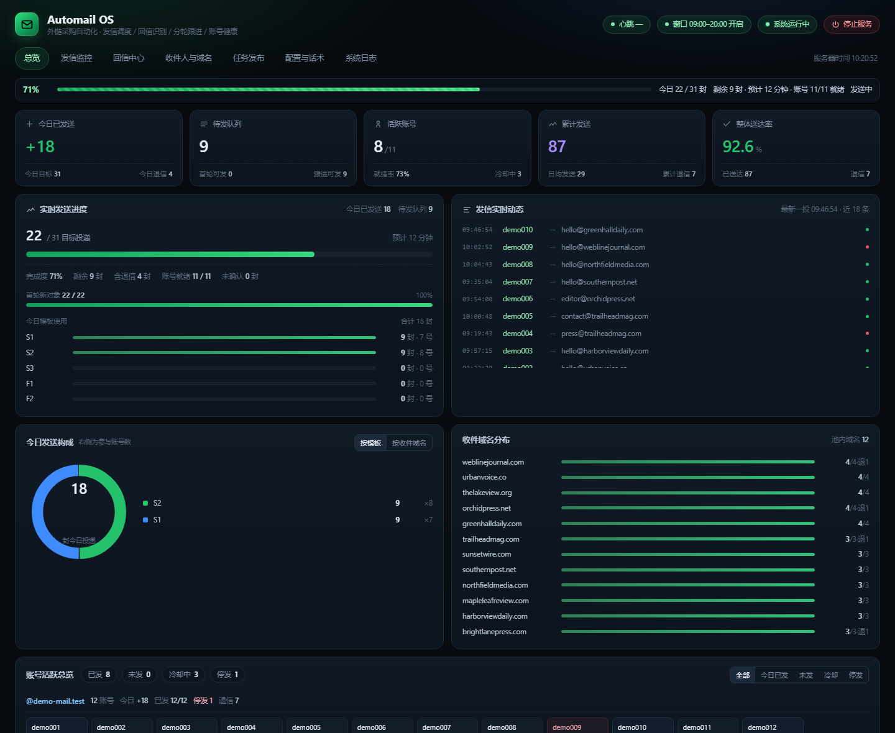
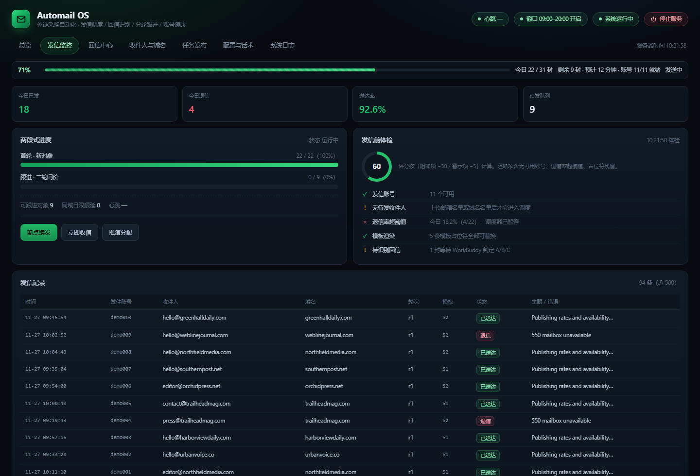
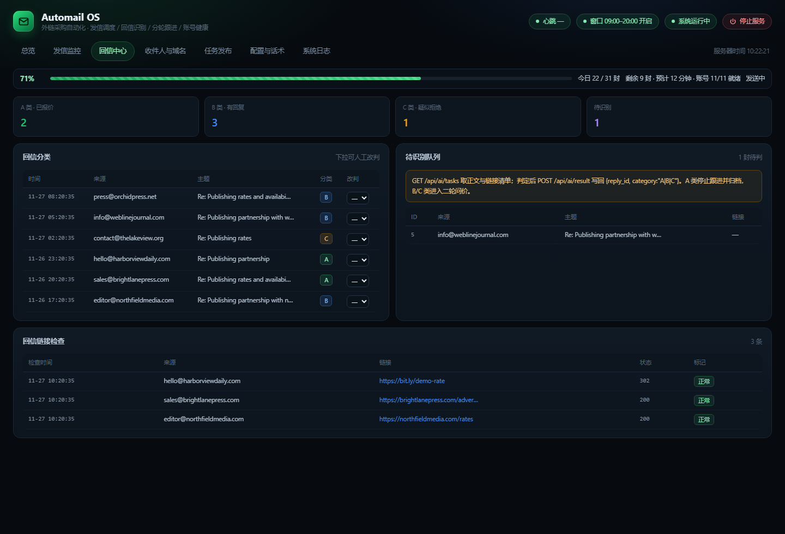

# Automail Desk · 外联发信与回信处理台

面向外链采购、媒体投放等场景的本地发信工作台。服务端为 Python 标准库单文件实现，前端为单文件深色看板，数据落在本地 SQLite，不依赖任何云服务与第三方 SDK。



## 功能

| 模块 | 说明 |
|---|---|
| 账号池 | 多邮箱账号统一托管，记录单账号当日用量、冷却剩余、累计送达与退信 |
| 收件人池 | 支持 CSV / XLSX 名单上传，按域名归并、自动补全常见前缀、同域日限控制 |
| 模板与话术 | 首轮、二轮、跟进多套模板，支持 `{first_name}` `{domain}` `{company}` `{signature}` 等占位符 |
| 调度器 | 发送窗口、逐封抖动、单账号冷却、单账号日限、跟进间隔、退信率自动刹车 |
| 断点续发 | 发信前落 `sending` 记录，进程中断后自动收尾为「未确认」，支持一键续发与逐封处置 |
| 收信与分类 | IMAP 轮询收件箱与垃圾箱，回信按 A（有意向报价）/ B（有回复）/ C（可能拒绝）归类 |
| 链接检查 | 提取回信正文链接并实际请求，标记跳转、短链与可疑域名 |
| A 类导出 | 将 A 类回信整理为 HTML / Markdown 报价文档，附域名与价格 |
| 日志导出 | 按日期导出收发日志（XLSX / CSV） |
| 运行状态 | 全页签常驻进度条、心跳灯、发送窗口灯、右上角一键停止服务 |

发信监控与回信中心：

| 发信监控 | 回信中心 |
|---|---|
|  |  |

## 环境要求

- Python 3.9 及以上（仅标准库即可运行；导入 XLSX 名单与导出 Excel 需要 `openpyxl`）
- 企业邮箱需开启 SMTP / IMAP 服务，并允许客户端使用密码或授权码登录
- 操作系统：Windows 10/11、macOS、Linux 均可；Windows 另提供双击启动与桌面图标

## 快速开始

### 方式一：Windows 一键安装

PowerShell 中执行：

```powershell
irm https://raw.githubusercontent.com/o0OAdonisO0o/automail-desk/main/install.ps1 | iex
```

脚本依次完成：下载仓库 → 解压至 `%USERPROFILE%\AutomailDesk` → 创建虚拟环境并安装依赖 → 生成 `config.json` → 创建桌面快捷方式 → 启动面板并打开浏览器。

### 方式二：macOS / Linux 一键安装

```bash
curl -fsSL https://raw.githubusercontent.com/o0OAdonisO0o/automail-desk/main/install.sh | bash
cd ~/AutomailDesk && ./run.sh
```

### 方式三：源码运行

```bash
git clone https://github.com/o0OAdonisO0o/automail-desk.git
cd automail-desk
python -m venv .venv
source .venv/bin/activate          # Windows: .venv\Scripts\activate
pip install -r requirements.txt
cp config.example.json config.json # 填写域名、密码与服务商参数
python server.py                   # Windows 亦可双击 start.bat
```

面板地址固定为 <http://127.0.0.1:8765>，服务仅监听回环地址，不对局域网开放。

### 启动与停止

| 操作 | Windows | macOS / Linux |
|---|---|---|
| 启动（后台，自动开浏览器） | 双击 `start_silent.py` 或桌面图标 | `python launcher.py` |
| 启动（前台，可见日志） | `start.bat` | `./run.sh` |
| 停止 | 面板右上角「停止服务」，或 `python stop.py` | 同左 |
| 仅初始化账号池 | `python server.py seed` | 同左 |

## 配置

配置读取顺序：`config.json` → 环境变量（`AUTOMAIL_DOMAIN`、`AUTOMAIL_PASSWORD`、`AUTOMAIL_SMTP_HOST`、`AUTOMAIL_IMAP_HOST`、`AUTOMAIL_PORT`）→ 代码缺省值。`config.json` 含账号密码，已列入 `.gitignore`，不得提交到仓库。

| 字段 | 说明 | 示例 |
|---|---|---|
| `domain` | 发信账号所属域名 | `mail.example.com` |
| `password` | 账号统一密码或客户端授权码 | `ChangeMe123` |
| `smtp_host` / `smtp_port` | SMTP 服务地址，端口 465 走 SSL | `smtp.qiye.aliyun.com` / `465` |
| `imap_host` / `imap_port` | IMAP 服务地址，端口 993 走 SSL | `imap.qiye.aliyun.com` / `993` |
| `account_prefix` / `account_count` | 账号池命名规则与数量，生成 `前缀 + 三位序号 + @域名` | `send` / `10` |
| `recipient_xlsx` | 收件人表路径，首张工作表、第 2 行起读取；留空则仅通过面板上传 | `D:\data\leads.xlsx` |
| `port` | 面板端口 | `8765` |
| `sender_name` / `company_name` | 签名中的发件人与公司名 | `Leo Li` / `Your Company` |

常用邮件服务商参数：

| 服务商 | SMTP | IMAP |
|---|---|---|
| 阿里云企业邮箱 | `smtp.qiye.aliyun.com:465` | `imap.qiye.aliyun.com:993` |
| 腾讯企业邮箱 | `smtp.exmail.qq.com:465` | `imap.exmail.qq.com:993` |
| Google Workspace | `smtp.gmail.com:465` | `imap.gmail.com:993` |
| Microsoft 365 | `smtp.office365.com:587`（STARTTLS） | `outlook.office365.com:993` |
| Zoho Mail | `smtp.zoho.com:465` | `imap.zoho.com:993` |

Microsoft 365 与部分服务商要求 OAuth2 或应用专用密码，本项目使用基础认证，需先在服务商侧开启。

## 使用流程

1. **配置签名与话术**：「配置与话术」页填写发件人、公司、WhatsApp、退订声明，并按需调整模板。
2. **导入账号池**：`python server.py seed` 按配置批量生成，或在「收件人与域名」页上传账号 CSV（`email,password`）。
3. **导入收件人**：上传 CSV / XLSX，字段顺序为 `来源ID, 邮箱, 联系人, 行业, 公司, 域名`；亦可只上传域名，由系统按 `info,contact,sales` 补全。
4. **发信前体检**：监控页展示评分与逐项结论，覆盖账号可用数、收件人余量、退信率、模板占位符、域名集中度、发送窗口。
5. **发布任务**：设定轮次、单账号日限、冷却、同域日限、跟进间隔与发送窗口，点击「启动任务」。顶部进度条实时显示完成度、剩余封数、预计分钟与就绪账号。
6. **跟踪与处置**：发信记录逐封可见；中断残留可在监控页「标记已投递」或「重发」。
7. **回信处理**：面板拉取待识别回信（正文与链接清单），可接入外部模型判定 A/B/C，也可人工下拉改判；A 类一键导出报价文档。
8. **导出日志**：「系统日志」页按日期导出 XLSX / CSV。

## 调度与风控参数

| 参数 | 缺省 | 作用 |
|---|---|---|
| `daily_cap` | 3 | 单账号每日首轮上限 |
| `followup_cap` | 2 | 单账号每日跟进上限 |
| `cooldown_min` | 15 | 同一账号两封之间的最小间隔 |
| `send_gap_sec` | 20 | 全局逐封间隔，附加随机抖动 |
| `max_per_domain_day` | 3 | 同一收件域名每日上限，抑制集中投诉 |
| `followup_gap_hours` | 24 | 首轮与跟进的最小间隔 |
| `send_window_start` / `send_window_end` | 09:00 / 20:00 | 允许发信的时段，窗口外调度器挂起 |
| `bounce_pause_pct` / `bounce_min_sample` | 15 / 30 | 退信率达到阈值且样本足够时自动暂停 |

新启用域名建议保持缺省值或更低。日产能的真正上限由「账号数 × 单账号日限」与「收件人按域名折算数」两者取小决定，单纯增加账号不会提升已饱和队列的产出。

## 断点与恢复

发信前先写入 `sending` 记录，成功后转 `sent`，被拒转 `bounced`，异常转 `failed`。进程若在 SMTP 往返中退出，重启时 `recover_inflight()` 将该行判为未确认并占位收件人轮次，调度线程在运行态下继续派发，不重复打扰同一收件人。心跳超过 180 秒未更新，顶栏显示「调度心跳中断」。

处置方式三种：自动续跑、一键续发（`POST /api/resume`）、逐封标记已投递或重发。

## 目录结构

```
automail-desk/
├── server.py            服务端：调度、收发信、分类、链接检查、REST 接口
├── launcher.py          启动器：后台拉起服务并打开浏览器
├── start_silent.py      桌面快捷方式入口（调用 launcher）
├── stop.py              停止服务（优先调用 /api/shutdown）
├── start.bat / stop.bat Windows 启停脚本（纯 ASCII + CRLF）
├── run.sh               macOS / Linux 前台启动
├── install.ps1           Windows 一键安装
├── install.sh           macOS / Linux 一键安装
├── config.example.json  配置样例
├── requirements.txt     依赖（openpyxl）
├── ui/index.html        前端单文件看板
├── assets/              图标资源
├── tools/demo_seed.py   演示数据生成器（虚构地址，用于预览与截图）
└── docs/                截图
```

运行时生成 `data/automail.db`、`logs/`、`exports/`，均已列入 `.gitignore`。

预览界面而不接入真实邮箱：

```bash
python tools/demo_seed.py
AUTOMAIL_BASE=$(pwd)/_demo AUTOMAIL_PORT=8767 AUTOMAIL_READONLY=1 python server.py
```

`AUTOMAIL_READONLY=1` 的实例不启动调度与收信线程，不会发出任何邮件。

## HTTP 接口

| 接口 | 方法 | 用途 |
|---|---|---|
| `/api/dashboard` | GET | 看板聚合：KPI、进度、构成、动态、账号矩阵 |
| `/api/progress` | GET | 当日进度、剩余封数、预计耗时、未确认数 |
| `/api/account_detail?email=` | GET | 单账号详情与最近发信 |
| `/api/campaign` | POST | `{state: running\|paused\|idle}` |
| `/api/resume` | POST | 断点续发 |
| `/api/unknown` | GET / POST | 查询未确认邮件；`{id, action: sent\|retry}` 处置 |
| `/api/preflight` | GET | 发信前体检 |
| `/api/ai/tasks` | GET | 待识别回信（正文前 4000 字 + 链接清单） |
| `/api/ai/result` | POST | 写回分类结果，单条或 `{items:[...]}` 批量 |
| `/api/import/accounts\|recipients\|domains` | POST | 文件字节 + `X-Filename` 头 |
| `/api/export/daily?date=&fmt=xlsx\|csv` | GET | 当日收发日志 |
| `/api/export_a` | GET | A 类客户文档 |
| `/api/poll` | POST | 立即收一次信 |
| `/api/shutdown` | POST | 停止服务 |

接口无鉴权，服务只监听 `127.0.0.1`。如需跨机调用，须自行前置反向代理与访问控制。

## 常见问题

**端口被占用**：`PanelServer` 关闭了地址复用，旧进程未退出时新实例不会启动。执行 `python stop.py` 或面板右上角停止按钮。

**Windows 批处理乱码或提示「系统找不到指定的驱动器」**：`.bat` 文件须保持纯 ASCII 与 CRLF 换行。cmd 以本地代码页读取脚本，UTF-8 中文标点的尾字节会吞掉换行，导致行错位。

**IMAP 检索中文主题无结果**：服务端不依赖 `SEARCH SUBJECT`，改为拉取头部后在本地匹配，避免各服务商编码差异。

**退信率偏高**：新域名首周建议单账号日限 3 封、同域日限 3 封，并逐步放量。退信率超过 5% 时应暂停并清洗名单。

**邮件进入垃圾箱**：检查 SPF、DKIM、DMARC 记录是否齐全，发信域名与信封域是否一致，正文外链数量与图片比例是否过高。

## 合规与免责声明

本项目为自建发信工具，仅提供技术实现，不提供任何收件人数据。使用者须自行确保：

- 收件人地址来源合法，具备联系该地址的正当业务理由；
- 遵守所在司法辖区的反垃圾邮件与数据保护法规，包括但不限于 CAN-SPAM、GDPR、中国《个人信息保护法》与《反不正当竞争法》；
- 每封邮件包含真实发件人身份、有效联系方式与可执行的退订方式，退订请求须及时处理；
- 不得用于批量群发、欺诈、钓鱼或任何违法用途。

因使用本项目产生的投诉、封号、法律责任与损失，由使用者自行承担。

## License

[MIT](LICENSE)
